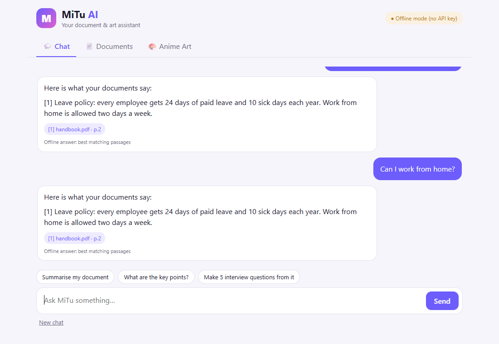
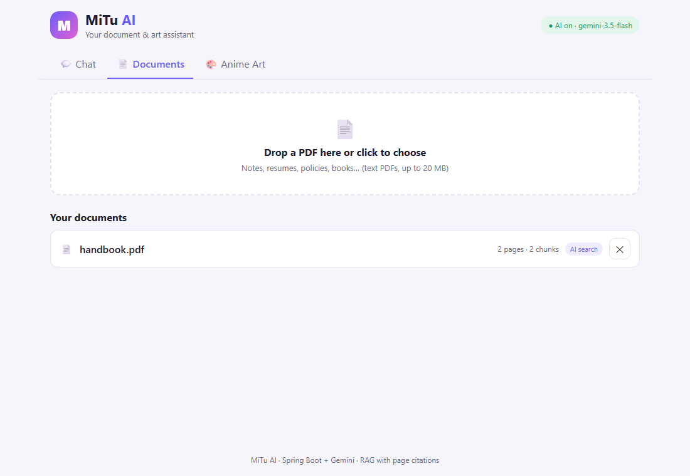
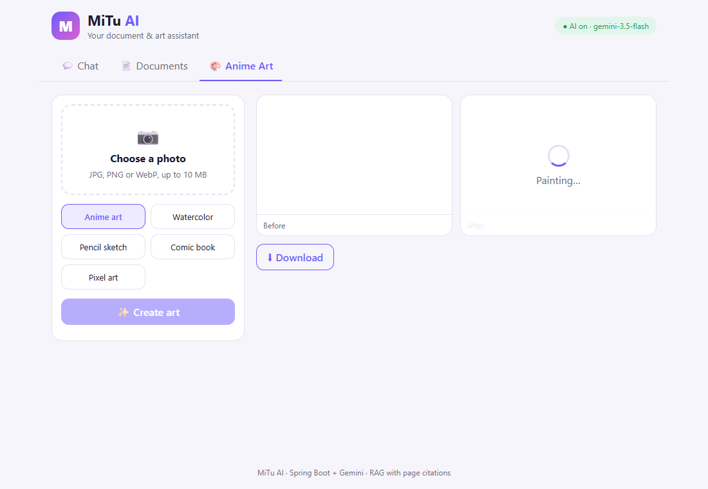
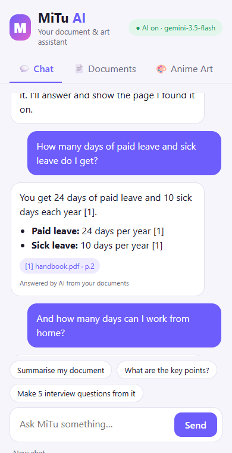
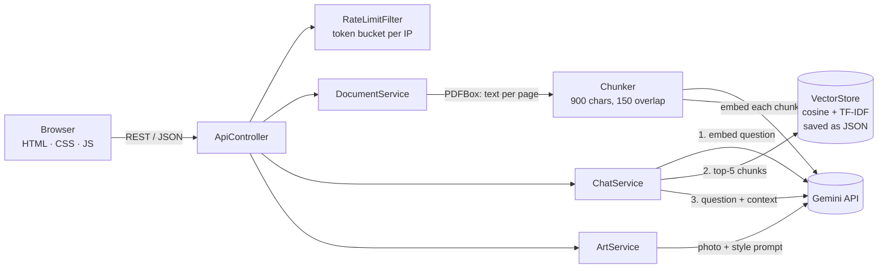

<div align="center">

# MiTu AI Assistant

**Chat with your PDFs and get answers with page citations. Turn photos into anime-style art.**

### 🌐 [Live demo: mitu-ai.onrender.com](https://mitu-ai.onrender.com)
<sub>Free hosting: the first visit can take ~40 s to wake up.</sub>

Built with Java 21 · Spring Boot 3 · Google Gemini · Retrieval-Augmented Generation (RAG)

[](https://github.com/Vineetsing9019/MiTu-AI/actions/workflows/ci.yml)




</div>

---

## What it does

| Feature | How it works |
|---|---|
| 📄 **Chat with your documents** | Upload any text PDF (notes, a policy, a book, a resume). MiTu splits it into chunks, turns each chunk into an embedding and finds the passages that match your question by meaning. |
| 🔎 **Answers with sources** | Every answer shows chips like `handbook.pdf · p.2`, so you can check exactly where it came from. The AI is told to answer from your documents only and to say when the answer isn't there. |
| 🧠 **Conversation memory** | Follow-up questions ("and for sick leave?") work, because each chat keeps its recent turns. |
| 🎨 **Anime art from photos** | Upload a photo and pick a style (Anime, Watercolor, Pencil sketch, Comic, Pixel art). Gemini's image model redraws it while keeping the same people and scene. |
| 🛟 **Never breaks in a demo** | With no API key, a rate limit or an AI outage, MiTu degrades gracefully: keyword (TF-IDF) search answers with the best passages, and a browser-side image filter (Sobel edges + colour quantisation) still produces art. |
| 🛡️ **Safe to put online** | A per-visitor token-bucket rate limiter protects the free AI quota. The API key only ever lives in an environment variable. |

<p align="center">
  
  
</p>
<p align="center"></p>

---

## Architecture



### How a question is answered (RAG)

1. **Ingest:** PDFBox reads the PDF **page by page**, so every chunk remembers its page number.
2. **Chunk:** the text is cut into ~900-character pieces with a 150-character overlap, at sentence ends where possible, so no fact is split in half.
3. **Embed:** each chunk becomes a 768-number vector (`gemini-embedding-001`) that captures its meaning.
4. **Retrieve:** the question is embedded the same way. **Cosine similarity** finds the 5 closest chunks.
5. **Generate:** those chunks are sent to `gemini-3.5-flash` with numbered tags (`[1] handbook.pdf, page 2`) and strict instructions: answer from the context, cite it, and never invent page numbers.
6. **Show sources:** the page shows the citations, with the passage on hover.

### Design decisions

| Decision | Why |
|---|---|
| Plain REST calls to Gemini (Spring `RestClient`) | The whole request/response is visible and easy to explain. Changing the model is one property. |
| Own in-memory vector store, saved to JSON | No database to set up, so it runs anywhere with `java -jar`. For millions of chunks it would be swapped for PostgreSQL + pgvector behind the same `search()` method. |
| Page-by-page extraction | Citations need real page numbers, and a page is a natural chunk boundary. |
| Overlapping chunks | A sentence cut at a chunk edge still appears whole in the next chunk. |
| Keyword fallback (TF-IDF) | Search still works with no API key or when the free quota runs out. |
| Art via the browser filter when offline | The art feature always produces something, even on a live demo with no network to the AI. |
| Model fallback chain | Google retires and rate-limits models often. A model that is retired (404), busy (503) or over quota (429) falls through to the next one in the list, so users never see the outage. |
| Only cited sources shown | The chips under an answer are the passages the AI actually used (`[1]`, `[2]`), not everything the search returned. |
| Token-bucket rate limit | Smooth limits (20/min per visitor by default) instead of hard resets, and cheap: O(1) per request. |

---

## Run it locally

You need **Java 21**. Maven isn't required, because the wrapper downloads it.

```bash
git clone https://github.com/Vineetsing9019/MiTu-AI.git
cd MiTu-AI

# Optional but recommended: a free key from https://aistudio.google.com/apikey
# Either put it in a .env file in the project folder (git-ignored):
echo "GEMINI_API_KEY=your_key_here" > .env
# or set it in the shell: export GEMINI_API_KEY=your_key_here   (PowerShell: $env:GEMINI_API_KEY="your_key_here")

./mvnw spring-boot:run                        # Windows: mvnw.cmd spring-boot:run
```

Open **http://localhost:8080**. Without a key, the badge says *Offline mode* and everything still works with the fallbacks.

> **Free vs paid Gemini:** chat and embeddings work on the free plan. AI image generation needs billing turned on in Google AI Studio (a few rupees per image). Without it, MiTu says so and paints the picture with its offline filter.

### With Docker

```bash
docker build -t mitu-ai .
docker run -p 8080:8080 -e GEMINI_API_KEY=your_key_here mitu-ai
```

## Deploy it free (Render)

1. Push this repo to GitHub.
2. On [render.com](https://render.com): **New → Blueprint**, then pick the repo. `render.yaml` sets everything up.
3. In the service's **Environment** settings, add `GEMINI_API_KEY`.
4. Open the `https://mitu-ai-….onrender.com` link.

> The free plan sleeps after 15 minutes idle, so the first visit takes ~40 s to wake. Its disk is temporary: uploaded documents reset on each deploy.

## Configuration

| Variable | Default | What it does |
|---|---|---|
| `GEMINI_API_KEY` | *(empty: offline mode)* | Google AI Studio key |
| `GEMINI_CHAT_MODEL` | `gemini-3.5-flash,gemini-flash-lite-latest,gemini-flash-latest` | Models that write answers, tried in order |
| `GEMINI_EMBED_MODEL` | `gemini-embedding-001` | Model that makes embeddings |
| `GEMINI_IMAGE_MODEL` | `gemini-3.1-flash-image,gemini-2.5-flash-image` | Models that redraw photos, tried in order |
| `MITU_RATE_LIMIT` | `20` | AI requests per visitor per minute |
| `MITU_DATA_DIR` | `data` | Where the document index is saved |
| `PORT` | `8080` | HTTP port |

## REST API

| Method | Path | Body | Returns |
|---|---|---|---|
| `GET` | `/api/status` | – | AI on/off, models, art styles |
| `POST` | `/api/documents` | multipart `file` (PDF) | the indexed document (pages, chunks) |
| `GET` | `/api/documents` | – | all documents |
| `DELETE` | `/api/documents/{id}` | – | `204` |
| `POST` | `/api/chat` | `{"question": "...", "sessionId": "..."}` | `{answer, sources[], mode}` |
| `DELETE` | `/api/chat/{sessionId}` | – | starts a new conversation |
| `POST` | `/api/art` | multipart `photo`, `style` | the image (`503` + `offline:true` without a key) |

Errors always come back as `{"message": "..."}` with a fitting status code (`400`, `413`, `429`, `503`).

## Tests

```bash
./mvnw test
```

13 tests cover chunking, cosine similarity, vector ranking, citation parsing, the AI being told the date, a real PDF going through upload → search → cited answer → restart → delete, input validation, the offline art signal and the rate limiter's refill. GitHub Actions runs them, plus a Docker build, on every push.

## Project structure

```
src/main/java/com/mitu/ai
├── MituApplication.java
├── ai/        GeminiClient (chat, embeddings, image editing), settings, errors
├── rag/       DocumentService (PDF → chunks → vectors), Chunker, VectorStore
├── chat/      ChatService (retrieve → prompt → answer with sources, memory)
├── art/       ArtService (styles → image prompt)
└── web/       ApiController, ErrorHandler, RateLimitFilter
src/main/resources/static   index.html · styles.css · app.js (UI + offline art filter)
```

## Roadmap

- Streaming answers word by word (Server-Sent Events)
- PostgreSQL + pgvector for large libraries, with per-user accounts (Spring Security + JWT)
- OCR for scanned PDFs
- Hybrid search: combine vector and keyword scores, and add a reranker

## License

MIT © Vineetsing Girase
